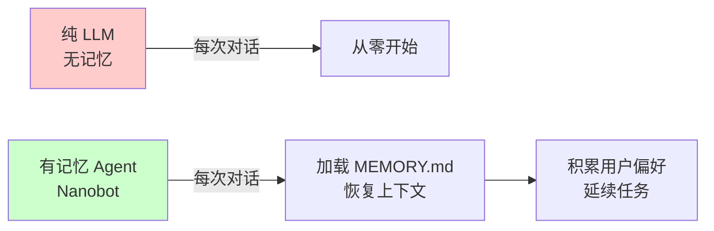
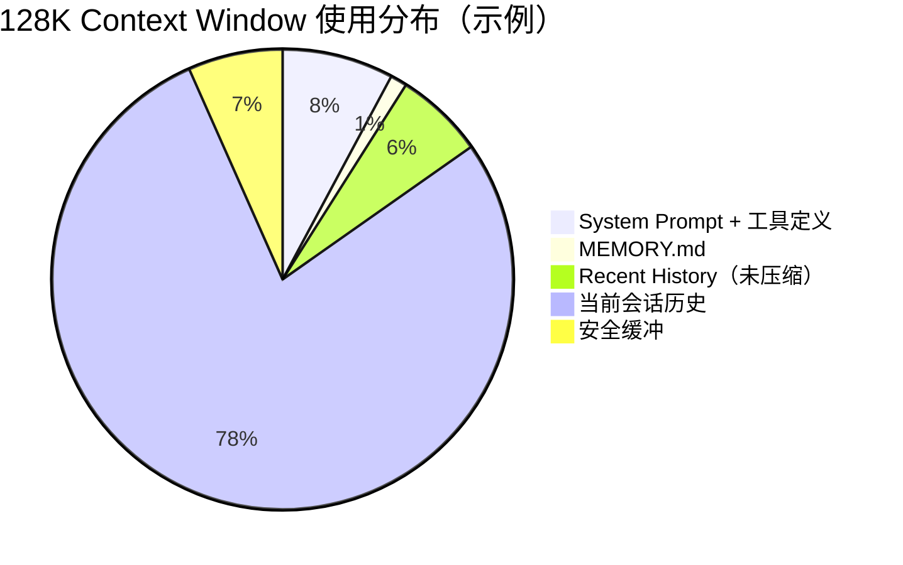
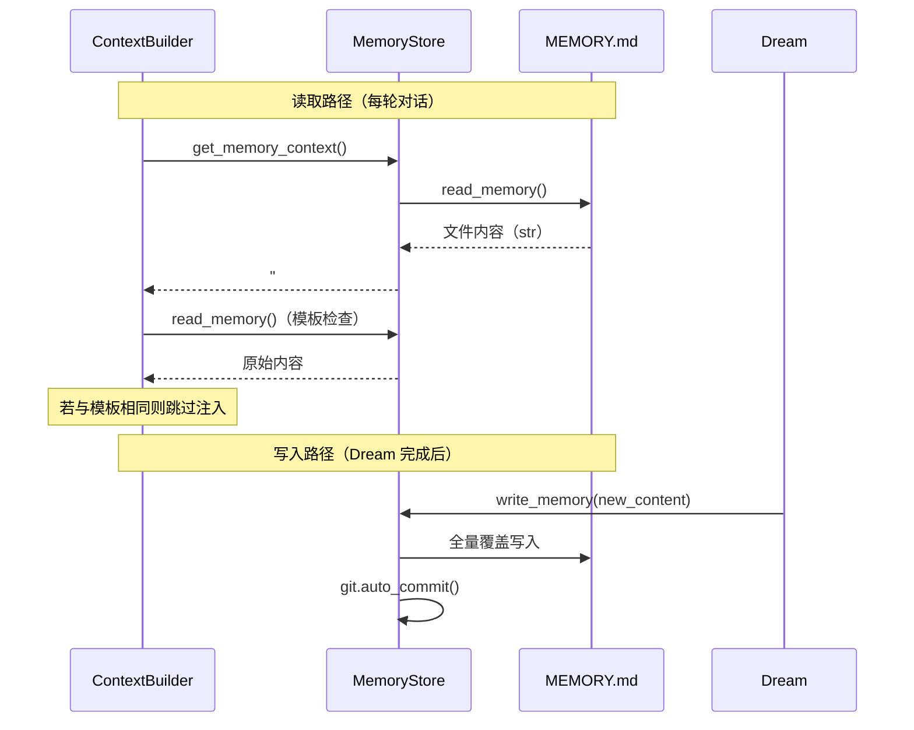
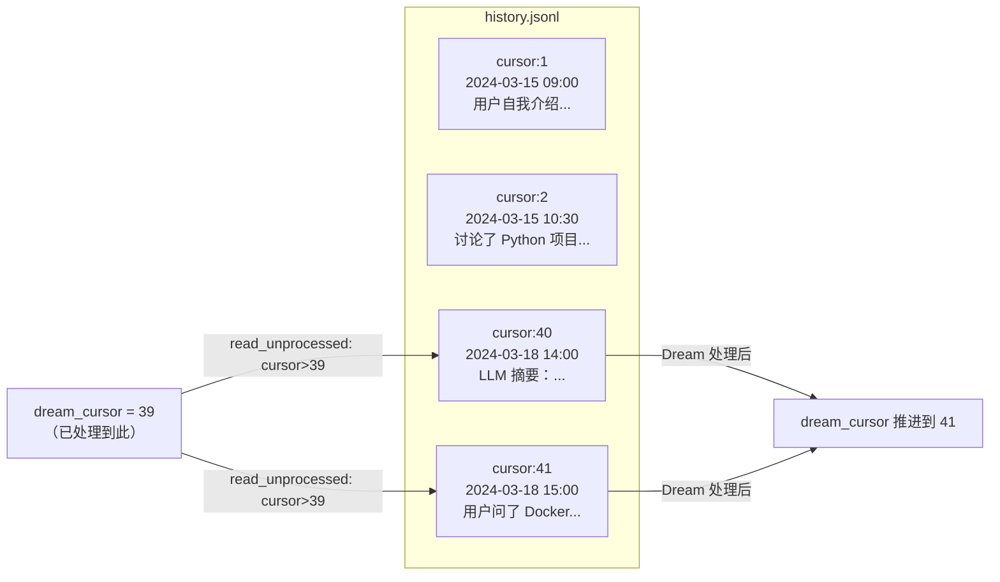
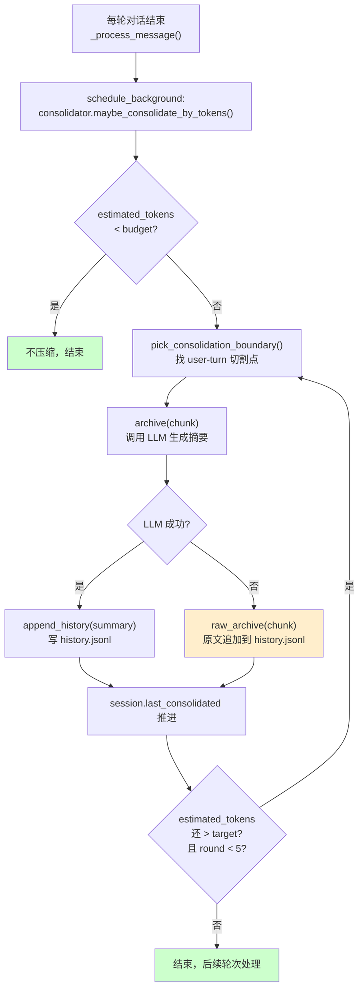
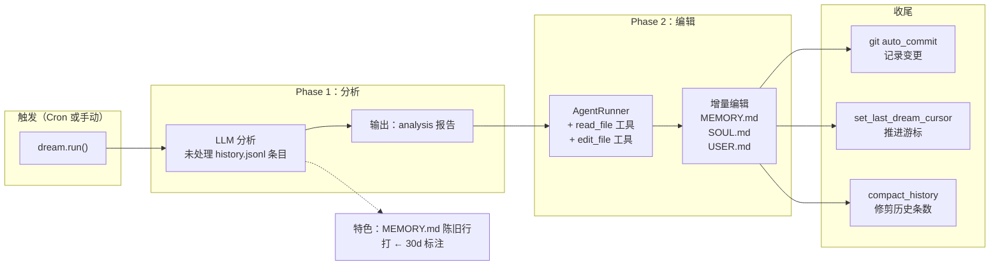
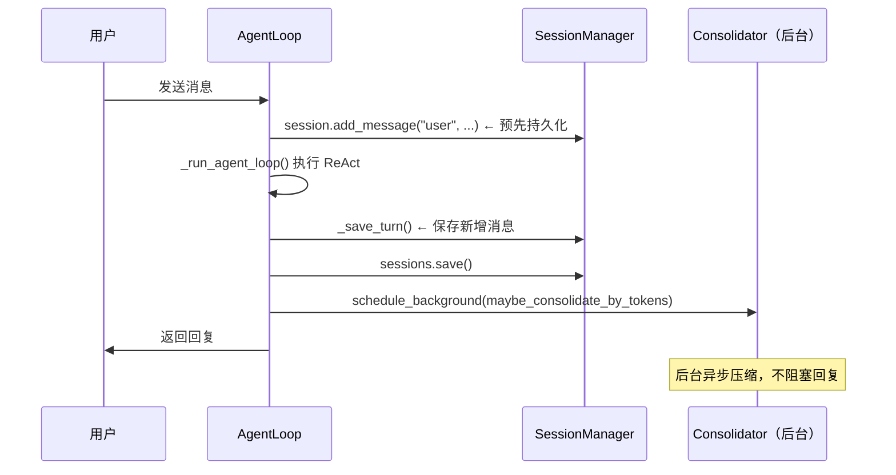
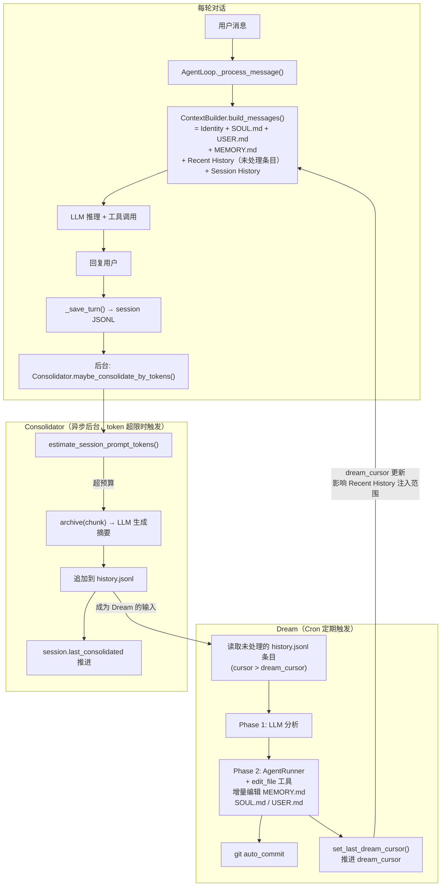

# Nanobot 记忆系统学习提纲（源码验证修正版）

> **版本说明**：本文档基于 `/Users/chenyuhang/nanobot` 实际源码验证生成。
> 原参考资料（`learn-nanobot/docs/07-memory-system`）中存在大量与源码不符的描述，
> 已在本文档全部修正。每处引用均附实际源码文件路径和行号。

---

## 目录

- [A. 修正后章节提纲](#a-修正后章节提纲)
  - [7.1 为什么 Agent 需要记忆](#71-为什么-agent-需要记忆)
  - [7.2 记忆系统的挑战](#72-记忆系统的挑战)
  - [7.3 Nanobot 实际记忆架构（四文件 + 三类）](#73-nanobot-实际记忆架构四文件--三类)
  - [7.4 MemoryStore — 纯文件 I/O 层](#74-memorystore--纯文件-io-层)
  - [7.5 history.jsonl — 历史时间线](#75-historyjsonl--历史时间线)
  - [7.6 Consolidator — 基于 Token 预算的轻量压缩](#76-consolidator--基于-token-预算的轻量压缩)
  - [7.7 Dream — 两阶段重量级记忆处理（文档未覆盖）](#77-dream--两阶段重量级记忆处理文档未覆盖)
  - [7.8 短期记忆：Session JSONL](#78-短期记忆session-jsonl)
  - [7.9 记忆系统完整数据流（修正版）](#79-记忆系统完整数据流修正版)
  - [7.10 记忆系统与其他框架对比](#710-记忆系统与其他框架对比)
- [B. 提纲修正记录](#b-提纲修正记录)
- [C. 推荐学习资料](#c-推荐学习资料)

---

## A. 修正后章节提纲

---

### 7.1 为什么 Agent 需要记忆

#### 【核心要点】
无记忆 Agent 每次对话从零开始，无法积累用户偏好和任务上下文。记忆系统让 Agent 具备跨会话的延续性，是从"工具"升级为"助手"的关键能力。设计记忆系统的核心矛盾是：完整性、成本、实时性三者的平衡。

#### 【关键代码片段】

这一节以概念为主，代码引用意义不大。可以引用 ContextBuilder 中 system prompt 构建的整体结构作为铺垫：

```python
# context.py:31-66  build_system_prompt()
def build_system_prompt(self, skill_names=None, channel=None) -> str:
    parts = [self._get_identity(channel=channel)]     # 身份
    bootstrap = self._load_bootstrap_files()           # SOUL.md / USER.md / AGENTS.md
    memory = self.memory.get_memory_context()          # MEMORY.md
    # ... skills, recent history
    return "\n\n---\n\n".join(parts)
```

#### 【建议配图】



#### 【留白区域】
- 你在实际使用中遇到的"AI 失忆"场景是什么？有没有因为 AI 不记得你的偏好而反复重新解释的经历？
- 你认为记忆系统对哪类场景最关键（客服 Bot？编程助手？个人日历管理？）

#### 【预估字数】
约 600-800 字（概念解释为主，配一张对比表）

---

### 7.2 记忆系统的挑战

#### 【核心要点】
上下文窗口本质是 Agent 的"工作记忆"，它是有限的。System Prompt、工具定义、会话历史共同争夺这个空间。业界方案各有取舍，Nanobot 选择"文件存储"是一种极简主义的权衡，而非技术上最优的方案。

#### 【关键代码片段】

```python
# memory.py:536-538  Consolidator._input_token_budget
@property
def _input_token_budget(self) -> int:
    """Available input token budget for consolidation LLM."""
    return self.context_window_tokens - self.max_completion_tokens - self._SAFETY_BUFFER
# _SAFETY_BUFFER = 1024  (memory.py:448)
```

这段代码揭示了 token 预算的计算方式：总窗口 - 最大输出 - 安全缓冲。

#### 【建议配图】



#### 【留白区域】
- 你在设置 `context_window_tokens` 时遇到过 OOM 或截断吗？
- 对"滑动窗口 vs 摘要压缩 vs 向量检索"三种方案，你觉得各自的最大缺陷是什么？

#### 【预估字数】
约 500-700 字（对比表为主，可以结合 memory.py 顶部常量做量化说明）

---

### 7.3 Nanobot 实际记忆架构（四文件 + 三类）

#### 【核心要点】
原文档描述的是"双层架构（MEMORY.md + HISTORY.md）"，实际源码管理四个持久化文件，并由三个独立的类分工协作。`HISTORY.md` 已是遗留格式，现代 Nanobot 使用 `history.jsonl`。这种设计分离了"I/O 层"、"压缩层"和"深度整合层"的职责。

#### 【关键代码片段】

```python
# memory.py:33-59  MemoryStore.__init__
class MemoryStore:
    """Pure file I/O for memory files: MEMORY.md, history.jsonl, SOUL.md, USER.md."""

    def __init__(self, workspace: Path, max_history_entries: int = 1000):
        self.memory_file   = self.memory_dir / "MEMORY.md"     # 长期记忆
        self.history_file  = self.memory_dir / "history.jsonl" # 历史时间线（新格式）
        self.legacy_history_file = self.memory_dir / "HISTORY.md"  # 旧格式（自动迁移）
        self.soul_file  = workspace / "SOUL.md"   # Agent 个性/行为规范
        self.user_file  = workspace / "USER.md"   # 用户画像
        # Git 追踪（仅对这三个文件）
        self._git = GitStore(workspace, tracked_files=[
            "SOUL.md", "USER.md", "memory/MEMORY.md",
        ])
```

```python
# loop.py:282-302  三个类的初始化（AgentLoop.__init__）
self.consolidator = Consolidator(      # 轻量压缩器
    store=self.context.memory,
    context_window_tokens=self.context_window_tokens,
    ...
)
self.auto_compact = AutoCompact(...)   # TTL 会话管理
self.dream = Dream(                    # 重量级记忆整合
    store=self.context.memory,
    provider=provider,
    model=self.model,
)
```

#### 【建议配图】

```mermaid
graph TB
    subgraph 文件层 ["持久化文件（workspace/）"]
        M["MEMORY.md<br/>长期事实记忆"]
        H["memory/history.jsonl<br/>历史时间线 JSONL"]
        S["SOUL.md<br/>Agent 个性规范"]
        U["USER.md<br/>用户画像"]
        SJ["sessions/*.jsonl<br/>短期会话历史"]
    end

    subgraph 类层 ["核心类"]
        MS["MemoryStore<br/>纯文件 I/O"]
        CON["Consolidator<br/>Token 预算压缩"]
        DR["Dream<br/>两阶段深度整合"]
    end

    MS -->|读写| M & H & S & U
    CON -->|archive() 写摘要| H
    CON -->|不直接修改| M
    DR -->|Phase2: edit_file 工具| M & S & U
    DR -->|读取| H

    subgraph 注入层 ["System Prompt 注入"]
        CB["ContextBuilder.build_system_prompt()"]
    end

    M -->|get_memory_context()| CB
    H -->|read_unprocessed_history()| CB
    S -->|_load_bootstrap_files()| CB
    U -->|_load_bootstrap_files()| CB
```

#### 【留白区域】
- 你第一次看到 Dream 类时有什么感受？"Agent 用 Agent 来整理自己的记忆"这个设计你觉得优雅还是过度工程？
- SOUL.md 和 USER.md 的分离意味着什么？你会怎么写 SOUL.md？

#### 【预估字数】
约 800-1000 字（这是整章最重要的架构图，可多花笔墨）

---

### 7.4 MemoryStore — 纯文件 I/O 层

#### 【核心要点】
MemoryStore 是无业务逻辑的纯 I/O 封装，所有方法只做读/写文件，不调用 LLM。MEMORY.md 的更新只有两种路径：`write_memory()`（全量覆盖）由 Dream 类调用；历史摘要写入 `history.jsonl` 由 Consolidator 调用。**原文档描述的 `save_memory()` 追加方法不存在。**

#### 【关键代码片段】

```python
# memory.py:197-223  MemoryStore 的读写接口

def read_memory(self) -> str:                    # L197
    return self.read_file(self.memory_file)

def write_memory(self, content: str) -> None:    # L200（全量覆盖，无时间戳）
    self.memory_file.write_text(content, encoding="utf-8")

def get_memory_context(self) -> str:             # L221（用于注入 System Prompt）
    long_term = self.read_memory()
    return f"## Long-term Memory\n{long_term}" if long_term else ""

# context.py:43-45  System Prompt 中的注入逻辑
memory = self.memory.get_memory_context()
if memory and not self._is_template_content(self.memory.read_memory(), "memory/MEMORY.md"):
    parts.append(f"# Memory\n\n{memory}")
# 注意：如果 MEMORY.md 内容与出厂模板相同（未定制），不会注入！
```

```python
# memory.py:56-58  Git 追踪
self._git = GitStore(workspace, tracked_files=[
    "SOUL.md", "USER.md", "memory/MEMORY.md",
])
# MEMORY.md 的每次 Dream 更新都可以通过 git log 追溯
```

#### 【建议配图】



#### 【留白区域】
- `_is_template_content()` 的设计意图：防止把"出厂空模板"注入上下文，减少 token 浪费。你觉得这个设计考虑周到吗？有没有可能误判？
- Git 追踪 MEMORY.md 变更——你有没有想过用 `git log` 来查看 AI 对你的了解是如何演变的？

#### 【预估字数】
约 600-800 字

---

### 7.5 history.jsonl — 历史时间线

#### 【核心要点】
原文档描述的 `HISTORY.md` 已是遗留格式，Nanobot 已迁移到结构化的 `history.jsonl`（JSON Lines 格式），每条记录包含自增 cursor、时间戳和内容字符串。Cursor 机制让 Dream 能精确知道"哪些历史已被处理"。

#### 【关键代码片段】

```python
# memory.py:227-267  append_history() 的实际实现

def append_history(self, entry: str, *, max_chars: int | None = None) -> int:
    """参数是 str，不是 dict！返回 cursor 编号。"""
    limit = max_chars if max_chars is not None else _HISTORY_ENTRY_HARD_CAP  # 64_000
    cursor = self._next_cursor()
    ts = datetime.now().strftime("%Y-%m-%d %H:%M")
    raw = entry.rstrip()
    if len(raw) > limit:
        raw = truncate_text(raw, limit)
    content = strip_think(raw)   # 移除 <think> 标签
    record = {"cursor": cursor, "timestamp": ts, "content": content}
    with open(self.history_file, "a", encoding="utf-8") as f:
        f.write(json.dumps(record, ensure_ascii=False) + "\n")
    self._cursor_file.write_text(str(cursor), encoding="utf-8")  # 更新 .cursor 文件
    return cursor
```

```python
# memory.py:312-314  Dream 游标机制
def read_unprocessed_history(self, since_cursor: int) -> list[dict]:
    """返回 cursor > since_cursor 的条目——Dream 用这个判断"还有多少没处理"。"""
    return [e for e, c in self._iter_valid_entries() if c > since_cursor]
```

```python
# history.jsonl 实际格式（每行一个 JSON）
{"cursor": 42, "timestamp": "2024-03-15 14:30", "content": "用户询问了 FastAPI CRUD 接口写法，解决了 JWT 认证问题"}
{"cursor": 43, "timestamp": "2024-03-15 16:00", "content": "[RAW] 3 messages\n[14:00] USER: ..."}
```

#### 【建议配图】



#### 【留白区域】
- 为什么用 JSONL 而不是普通 JSON 数组？（追加写入的性能和原子性）
- `.cursor` 文件的存在：这是一个"读写优化"——避免每次 append 都要扫描整个文件计算最大 cursor。你还见过哪些类似的"游标文件"设计？

#### 【预估字数】
约 700-900 字

---

### 7.6 Consolidator — 基于 Token 预算的轻量压缩

#### 【核心要点】
原文档描述的 `MemoryConsolidator` 不存在，实际类名是 `Consolidator`，触发条件是 **token 数超预算**（而非"记录数 > 50"）。它只操作 `history.jsonl`（追加摘要），**不直接修改 MEMORY.md**。原文档描述的 `save_memory` 工具、`tool_choice` 强制调用、三级容错均不存在。

#### 【关键代码片段】

```python
# memory.py:589-692  maybe_consolidate_by_tokens() 核心流程

async def maybe_consolidate_by_tokens(self, session, *, session_summary=None):
    budget = self._input_token_budget  # context_window - max_tokens - 1024
    target = int(budget * self.consolidation_ratio)  # 默认 ratio=0.5，压缩到 50%

    estimated, source = self.estimate_session_prompt_tokens(session)
    if estimated < budget:
        return  # 未超预算，不压缩

    for round_num in range(self._MAX_CONSOLIDATION_ROUNDS):  # 最多 5 轮
        if estimated <= target:
            break
        boundary = self.pick_consolidation_boundary(session, estimated - target)
        chunk = session.messages[session.last_consolidated:boundary[0]]
        summary = await self.archive(chunk)       # 调用 LLM 生成摘要
        session.last_consolidated = boundary[0]   # 推进游标
        if not summary:
            break  # LLM 降级，本轮停止
```

```python
# memory.py:554-587  archive() — 唯一的 LLM 调用点

async def archive(self, messages: list[dict]) -> str | None:
    formatted = MemoryStore._format_messages(messages)
    response = await self.provider.chat_with_retry(
        model=self.model,
        messages=[
            {"role": "system", "content": render_template("agent/consolidator_archive.md")},
            {"role": "user", "content": formatted},
        ],
        tools=None,          # 无工具！不是 tool_choice
        tool_choice=None,    # 直接生成摘要文本
    )
    summary = response.content or "[no summary]"
    self.store.append_history(summary, max_chars=8_000)  # 写 history.jsonl
    return summary
```

```python
# memory.py:416-424  raw_archive() — 降级路径（LLM 调用失败时）
def raw_archive(self, messages: list[dict], *, max_chars=None) -> None:
    formatted = truncate_text(self._format_messages(messages), limit)
    self.append_history(f"[RAW] {len(messages)} messages\n{formatted}")
    logger.warning("Memory consolidation degraded: raw-archived {} messages", len(messages))
```

#### 【建议配图】



#### 【留白区域】
- `consolidation_ratio=0.5` 意味着压缩目标是预算的一半。这个参数是经验值——你会如何根据实际使用调整它？
- 注意 `_schedule_background()`：压缩是**异步后台任务**，不阻塞当前回复。这意味着什么？有没有可能在极端情况下压缩和新消息写入产生竞争？
- 原文档描述的"三级容错（tool_choice → auto → Raw Archive）"完全虚构。实际只有两级：LLM 调用 → raw_archive 降级。你觉得文档作者为什么会这样描述？

#### 【预估字数】
约 900-1100 字（这是技术含量最高的章节，需要细讲 token budget 计算）

---

### 7.7 Dream — 两阶段重量级记忆处理（文档未覆盖）

#### 【核心要点】
Dream 是原文档完全遗漏的关键组件，也是**实际更新 MEMORY.md 的唯一机制**。它通过两阶段处理：Phase 1 用 LLM 分析未处理的 history.jsonl 条目，Phase 2 让一个迷你 AgentRunner 持有 read_file/edit_file 工具，对 MEMORY.md、SOUL.md、USER.md 做增量编辑。还有一个特色功能：对 MEMORY.md 做 git blame，给陈旧（>14天）的行打上 `← 30d` 标注，提示 LLM 哪些信息可能过时。

#### 【关键代码片段】

```python
# memory.py:706-743  Dream 类定义

class Dream:
    """Two-phase memory processor: analyze history.jsonl, then edit files via AgentRunner."""
    _STALE_THRESHOLD_DAYS = 14    # 超过 14 天的 MEMORY.md 行被标注为陈旧
    _MEMORY_FILE_MAX_CHARS = 32_000

    def __init__(self, store, provider, model,
                 max_batch_size: int = 20,    # 每次最多处理 20 条历史
                 max_iterations: int = 10):   # Phase 2 AgentRunner 最多 10 轮
        self._runner = AgentRunner(provider)
        self._tools = self._build_tools()     # read_file + edit_file + write_file(仅 skills/)
```

```python
# memory.py:851-1003  Dream.run() 两阶段流程（精简版）

async def run(self) -> bool:
    # 只处理未被 Dream 处理的历史条目
    entries = self.store.read_unprocessed_history(since_cursor=last_cursor)
    batch = entries[:20]  # 最多取 20 条

    # Phase 1：分析（纯 LLM 调用，无工具）
    phase1_response = await self.provider.chat_with_retry(
        messages=[{"role": "system", "content": render_template("agent/dream_phase1.md")},
                  {"role": "user", "content": history_text + file_context}],
        tools=None,
    )
    analysis = phase1_response.content  # 分析报告

    # Phase 2：用 AgentRunner 做增量编辑
    result = await self._runner.run(AgentRunSpec(
        initial_messages=[{"role": "system", ...dream_phase2...},
                          {"role": "user", "content": analysis + file_context}],
        tools=self._tools,  # read_file + edit_file（可读写 MEMORY.md/SOUL.md/USER.md）
        max_iterations=10,
    ))

    # 推进 dream_cursor，让 Consolidator 的 "未处理" 判断准确
    self.store.set_last_dream_cursor(batch[-1]["cursor"])
    self.store.compact_history()   # 按 max_history_entries 修剪 history.jsonl

    # Git 自动提交（有实际修改时）
    if changelog and self.store.git.is_initialized():
        self.store.git.auto_commit(commit_msg)
```

```python
# memory.py:805-849  git blame 行龄标注（Dream Phase 1 特色功能）
def _annotate_with_ages(self, content: str) -> str:
    ages = self.store.git.line_ages("memory/MEMORY.md")
    for line, age in zip(lines, ages):
        if age.age_days > 14:
            annotated.append(f"{line}  ← {age.age_days}d")  # 提示 LLM 此行陈旧
```

#### 【建议配图】



#### 【留白区域】
- "Agent 用 AgentRunner 整理自己的记忆"——这是 Nanobot 最 meta 的设计。Phase 2 让 AI 持有文件编辑工具去改自己的记忆，这让你联想到什么？
- git blame + age annotation：这个设计非常工程化。你觉得对一个 AI 助手来说，让它知道"某条记忆已经 30 天没更新"有多大价值？
- Dream 默认是 cron 触发（非实时），这意味着 MEMORY.md 的更新是**有延迟**的。你能想到因此可能出现的问题吗？

#### 【预估字数】
约 700-900 字（重点说明和 Consolidator 的职责分工）

---

### 7.8 短期记忆：Session JSONL

#### 【核心要点】
每个会话存储为 `sessions/<session_key>.jsonl`，由 `SessionManager` 管理。`AgentLoop._save_turn()` 在每轮对话结束后把新消息保存到 Session，而不是调用 `MemoryStore.append_history()`（这两个是完全不同的路径）。Session 还有"大图片占位符替换"和"runtime context 块剥离"等细节处理。

#### 【关键代码片段】

```python
# loop.py:1163-1206  _save_turn() 实际实现

def _save_turn(self, session: Session, messages: list[dict], skip: int) -> None:
    for m in messages[skip:]:
        entry = dict(m)
        role, content = entry.get("role"), entry.get("content")

        if role == "tool":
            # 截断过长工具结果
            if isinstance(content, str) and len(content) > self.max_tool_result_chars:
                entry["content"] = truncate_text_fn(content, self.max_tool_result_chars)

        elif role == "user":
            # 剥离 [Runtime Context — metadata only] 块（时间戳等元数据不持久化）
            if isinstance(content, str) and content.startswith(ContextBuilder._RUNTIME_CONTEXT_TAG):
                ...

        entry.setdefault("timestamp", datetime.now().isoformat())
        session.messages.append(entry)
```

```python
# loop.py:1086-1092  _save_turn 的调用位置

save_skip = 1 + len(history) + (1 if user_persisted_early else 0)
self._save_turn(session, all_msgs, save_skip)   # 只保存新增消息
self.sessions.save(session)
# 压缩是异步后台任务——不阻塞回复
self._schedule_background(self.consolidator.maybe_consolidate_by_tokens(session))
```

#### 【建议配图】



#### 【留白区域】
- "用户消息预先持久化"设计（`user_persisted_early`）：如果 Agent 中途崩溃，用户消息还在，下次启动时会看到一条"Error: Task interrupted"的 assistant 回复。你觉得这个设计有多重要？
- runtime context 块（当前时间、channel 等元数据）在持久化时被剥离——为什么？（因为重新加载时会重新生成，不需要存历史时间）

#### 【预估字数】
约 600-800 字

---

### 7.9 记忆系统完整数据流（修正版）

#### 【核心要点】
实际数据流比文档描述复杂得多：涉及两个独立的压缩路径（Consolidator 对会话 messages 的压缩 vs Dream 对 history.jsonl 的整合）。两者通过 `dream_cursor` 协调：Consolidator 的产出（history.jsonl 摘要条目）是 Dream 的输入。

#### 【关键代码片段】

```python
# context.py:57-64  Recent History 注入（从 dream_cursor 至今的未处理历史）
entries = self.memory.read_unprocessed_history(
    since_cursor=self.memory.get_last_dream_cursor()
)
if entries:
    capped = entries[-50:]   # 最多 50 条
    history_text = "\n".join(f"- [{e['timestamp']}] {e['content']}" for e in capped)
    history_text = truncate_text(history_text, 32_000)
    parts.append("# Recent History\n\n" + history_text)
```

这段代码揭示了一个原文档完全未提到的机制：**未被 Dream 处理的 history.jsonl 条目会被注入到每次的 System Prompt 中**，以"Recent History"区块形式存在。

#### 【建议配图】



#### 【留白区域】
- 两个"压缩"路径的本质区别：Consolidator 压缩的是当前 **会话 messages**（减少 token 消耗），Dream 整合的是 **history.jsonl**（提炼到 MEMORY.md）。理解这个分工是理解整个系统的关键。
- 如果 Dream 长时间不跑（比如 cron 配置有问题），`Recent History` 会不断累积到 System Prompt 中。你能估算这会带来多大的 token 开销？

#### 【预估字数】
约 700-900 字（以图为主）

---

### 7.10 记忆系统与其他框架对比

#### 【核心要点】
原文档的对比框架基本准确，但 Nanobot 文件存储方案的优缺点需要基于实际架构重新描述：现在多了 Git 版本控制、Dream 的 per-line age annotation 等功能，让"透明可审计"成为更强的优势；但依赖文件 I/O 和 tiktoken 估算的精度问题是真实的局限。

#### 【关键代码片段】

```python
# memory.py:540-552  token 估算（基于 tiktoken）
def _truncate_to_token_budget(self, text: str) -> str:
    try:
        enc = tiktoken.get_encoding("cl100k_base")  # OpenAI 的分词器
        tokens = enc.encode(text)
        if len(tokens) <= budget:
            return text
        return enc.decode(tokens[:budget]) + "\n... (truncated)"
    except Exception:
        return truncate_text(text, budget * 4)  # 估算失败的 fallback
# 注意：cl100k_base 是 GPT 分词器，用于非 OpenAI 模型时可能有偏差
```

#### 【建议配图】

| 对比维度 | 向量库（Chroma/Pinecone）| Nanobot 文件方案 | MemGPT 虚拟分页 |
|---------|---------|---------|---------|
| 外部依赖 | 向量数据库 | 无（纯文件）| 无 |
| 语义检索 | ✅ | ❌ 关键词匹配 | ✅ 分层检索 |
| 可编辑性 | ❌ | ✅ 任何编辑器 | ❌ |
| 版本控制 | ❌ | ✅ git 追踪 | ❌ |
| 陈旧感知 | ❌ | ✅ git blame + age | ❌ |
| 实现复杂度 | 中 | 低 | 高 |
| 适合规模 | 大型知识库 | 个人助手 | 通用 |

#### 【留白区域】
- tiktoken 用的是 GPT 分词器（`cl100k_base`），如果用的是 Claude 或其他模型，token 估算会有多大偏差？这个偏差会导致什么问题？
- 你觉得 Nanobot 最适合哪类 Agent 场景？最不适合哪类？

#### 【预估字数】
约 600-800 字

---

## B. 提纲修正记录

| 原提纲描述 | 实际源码情况 | 需要看的文件/行号 | 建议改进方向 |
|-----------|------------|----------------|------------|
| 双层记忆架构（MEMORY.md + HISTORY.md） | 实际管理四个文件：MEMORY.md、history.jsonl、SOUL.md、USER.md；HISTORY.md 已是遗留格式 | `memory.py:43-59` | 改为"四文件架构"，增加 SOUL.md 和 USER.md 的说明 |
| `MemoryConsolidator` 类 | 类名是 `Consolidator`，无 `MemoryConsolidator` | `memory.py:443` | 全部替换为正确类名 |
| `CONSOLIDATION_THRESHOLD = 50`（记录数触发） | 不存在。触发条件是 token 数超预算（`input_token_budget`） | `memory.py:589-627` | 删除，改为 token 预算机制说明 |
| `save_memory(content)` 方法（追加写入带时间戳） | 该方法不存在。实际是 `write_memory()`（全量覆盖，无时间戳） | `memory.py:200-201` | 删除 `save_memory()` 描述，改为 `write_memory()` |
| `save_memory` 虚拟工具在 ToolRegistry 注册 | 不存在。`_register_default_tools()` 中无此注册 | `loop.py:345-393` | 整段删除，这部分内容完全虚构 |
| `_execute_tool()` 拦截 save_memory | 不存在。Runner 中工具执行是 `_run_tool()`，无拦截逻辑 | `runner.py:731` | 整段删除 |
| `tool_choice: {"name": "save_memory"}` 强制调用 | 不存在。Consolidator.archive() 直接 LLM call，`tool_choice=None` | `memory.py:566-578` | 删除，改为正确的 archive() 机制说明 |
| 三级容错：tool_choice → auto → Raw Archive | 实际只有两级：LLM 调用（archive()） → raw_archive() 降级 | `memory.py:554-587, 416-424` | 简化为两级，`raw_archive` 是降级路径而非第三级 |
| `maybe_consolidate()` 保留最近 10 条详细记录 | 方法名是 `maybe_consolidate_by_tokens()`，按 token 预算切割，无"10条"逻辑 | `memory.py:589, 490-510` | 重写为 token budget + pick_consolidation_boundary 机制 |
| `_summarize_with_llm()` | 不存在。等价逻辑是 `Consolidator.archive()` | `memory.py:554` | 替换为 `archive()` 的实际实现 |
| `append_history(turn_summary: dict)` | 签名是 `append_history(entry: str)`，接收字符串 | `memory.py:227` | 修正参数类型说明 |
| `append_history` 在每轮对话结束后调用 | 不在每轮调用。只在 Consolidator.archive() 和 raw_archive() 中调用 | `memory.py:582, 420` | 说明调用时机仅在压缩时 |
| Consolidator 负责更新 MEMORY.md | 完全错误。Consolidator 只写 history.jsonl。MEMORY.md 由 Dream 更新 | `memory.py:443-692, 706-1003` | 分别说明两个类的职责 |
| MEMORY.md "始终注入" System Prompt | 有条件判断：若内容与出厂模板相同（未定制）则不注入 | `context.py:43-45` | 加入"模板检查跳过"的说明 |
| 整个 Dream 类（完全未提及） | Dream 是更新 MEMORY.md 的唯一机制，需要完整介绍 | `memory.py:706-1003` | 新增 7.7 章节专门讲 Dream |
| Recent History 注入（完全未提及） | ContextBuilder 将 dream_cursor 之后的 history.jsonl 条目注入为 "# Recent History" | `context.py:57-64` | 在 7.3 架构图中体现，在 7.9 数据流中说明 |
| Git 追踪记忆文件（完全未提及） | MemoryStore 初始化 GitStore 追踪 SOUL.md/USER.md/MEMORY.md；Dream 做 git auto_commit 和 line-age annotation | `memory.py:56-58, 995-999` | 在 7.4 节加入"Git 版本控制"特性说明 |

---

## C. 推荐学习资料

> 以下资料针对原提纲中出错或理解不到位的知识点，按优先级排序。

---

### 1. MemGPT: Towards LLMs as Operating Systems（2023）

**论文标题**：MemGPT: Towards LLMs as Operating Systems  
**作者**：Charles Packer et al.（UC Berkeley）  
**关键词**：分层记忆、虚拟上下文、OS 类比

**为什么要看**：Nanobot 的 Consolidator 和 Dream 的分工（轻量实时压缩 vs 重量级后台整合），在架构思路上和 MemGPT 的"main context / external storage"分层非常相似。读完这篇论文，你会理解为什么把记忆分层是 AI Agent 领域的共识，以及 Nanobot 的文件方案和 MemGPT 的虚拟分页方案有什么本质取舍。**直接纠正原提纲中对 MemoryConsolidator 的错误理解**——论文里的 `archival_memory_insert` 和 `archival_memory_search` 才是你以为 Nanobot 在做的事。

---

### 2. Generative Agents: Interactive Simulacra of Human Behavior（2023）

**论文标题**：Generative Agents: Interactive Simulacra of Human Behavior  
**作者**：Joon Sung Park et al.（Stanford/Google）  
**关键词**：记忆流、反思、计划

**为什么要看**：这篇论文提出了"记忆流（Memory Stream）+ 反思（Reflection）+ 计划（Planning）"三层架构，是 Nanobot Dream 类两阶段设计的思想来源之一。Phase 1（分析）对应"反思"，Phase 2（编辑文件）对应将反思结果更新到长期记忆。读完能帮你理解 Dream 的"为什么"，而不只是"是什么"。同时，论文中的"重要性评分（importance score）"机制可以补充你对 Nanobot 缺失的"记忆选择性"功能的思考。

---

### 3. Anthropic Prompt Engineering Docs — System Prompts & Long Context

**来源**：Anthropic 官方文档（docs.anthropic.com）  
**关键节点**：System Prompt 最佳实践、上下文窗口利用策略、Prompt Caching

**为什么要看**：原提纲中说 System Prompt 包含"Identity + Bootstrap + Memory + Skills"，顺序是有意为之的，为了利用 Prompt Cache。这个原理在 Anthropic 官方文档中有详细说明。读完能让你理解 `context.py:build_system_prompt()` 中各部分的排列顺序为何是"不变内容在前，变化内容在后"，以及为什么 `history.jsonl` 的 "Recent History" 注入要放在 System Prompt 末尾（而非 user message）。

---

### 4. LangChain Memory 文档（Conceptual Guide: Memory）

**来源**：LangChain 官方文档  
**关键节点**：ConversationBufferMemory、ConversationSummaryMemory、VectorStoreRetrieverMemory

**为什么要看**：原提纲的对比表把 LangChain 和 Nanobot 并列，但描述失误（说 LangChain 用向量数据库且无压缩）。实际上 LangChain 有多种 Memory 实现，其中 `ConversationSummaryMemory` 的工作原理和 Nanobot 的 Consolidator 非常相似（都是 LLM 生成摘要替代原始对话）。读完能让你做出更准确的横向对比，理解 Nanobot 的设计取舍在工程上是否合理。

---

### 5. JSONL 格式规范与 Append-only Log 设计模式

**来源**：jsonlines.org 规范 + Martin Kleppmann《设计数据密集型应用》第3章（日志结构存储）

**为什么要看**：原提纲完全没有提到 `history.jsonl` 的格式变迁（从 HISTORY.md 到 JSONL），也没解释为什么选 JSONL 而非普通 JSON。理解 Append-only Log 的设计哲学（原子性追加、高效回放、简单故障恢复）能帮你真正理解 Nanobot 中 `.cursor` 文件存在的原因、`_write_entries()` 为什么要用 `os.fsync()` + atomic rename（`memory.py:362-387`），以及为什么历史文件"只追加从不修改"是一个工程上成熟的选择。

---

*文档生成时间：2026-05-16 | 源码版本：`/Users/chenyuhang/nanobot` main 分支*
